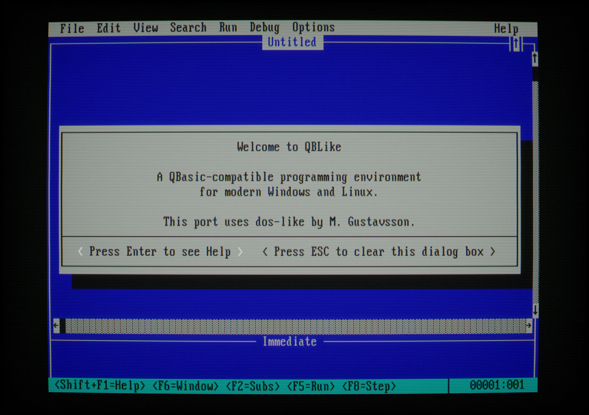
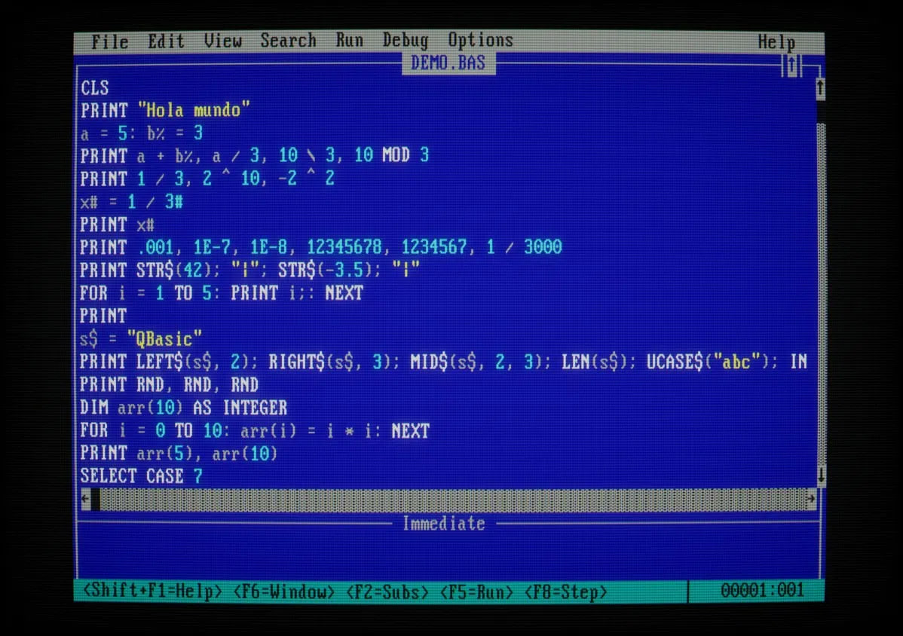
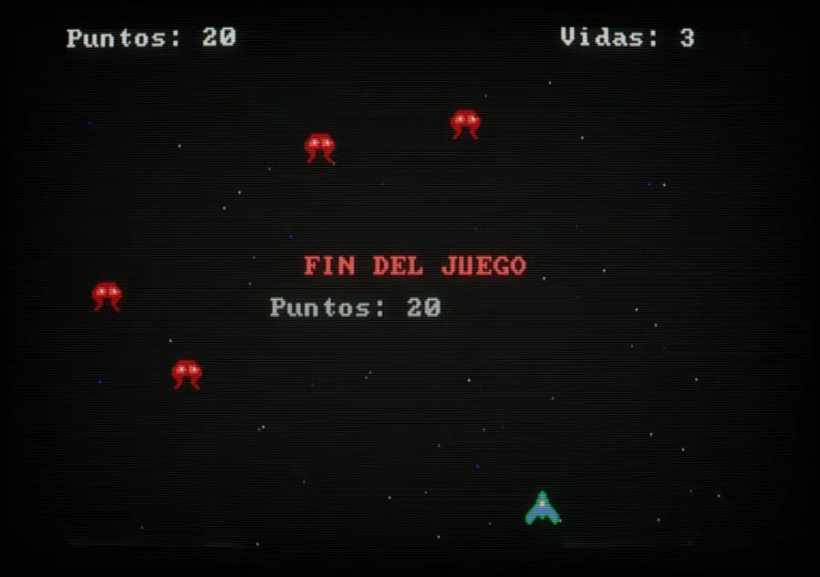

# QBLike

[English](#english) · [Español](#español)

---

## English

A **QBasic 1.1** compatible programming environment for native Windows and Linux,
built on [dos-like](https://github.com/mattiasgustavsson/dos-like) by Mattias Gustavsson.



It is a clean-room reimplementation: it contains no Microsoft code. It was written from the language
documentation and from the observable behavior of QBasic.

- **Same language**: `%` `&` `!` `#` `$` types, `TYPE`, `SUB`/`FUNCTION` with pass by reference,
  `DEF FN`, `GOSUB`, `ON ERROR`, `SELECT CASE`, `DATA`, sequential, random and binary files,
  `PRINT USING`, etc.
- **Same behavior**: `PRINT`/`STR$` number formatting (`.3333333`, `3.333333E-04`, `1D+20`…),
  banker's rounding in `CINT`, integer overflow errors, 14-column print zones, "Redo from start",
  and the same `RND` sequence as QBasic for the same seed.
- **Same environment**: blue screen, menus, *Immediate* window, each SUB in its own window (F2),
  automatic code formatting when leaving a line, syntax checking, debugger (F8/F10/F9),
  F1 help and "Press any key to continue".
- **Modern editor**: Shift selection, Ctrl+C/X/V with the system clipboard, Ctrl+Z/Y,
  word movement with Ctrl+arrows, mouse, syntax highlighting and a code formatter (Edit > Format Code).

### Usage

```
qblike                    opens the IDE
qblike program.bas        opens a program in the IDE
qblike /RUN program.bas   opens and runs it
qblike /X program.bas     runs it without the IDE (like a normal executable)
qblike -w ...             starts in a window (Alt+Enter or F11 toggle fullscreen)
```

Files can be in CP437 (like MS-DOS files) or UTF-8 (modern editors). The encoding is detected when
opening and kept when saving. On Linux, file names used by programs (`OPEN "DATA.TXT"...`) are matched
case-insensitively, and DOS-style paths are accepted.



### Keys

| Editing | |
|---|---|
| Shift + arrows / Home / End / PgUp / PgDn | select |
| Ctrl + ← / → | previous / next word |
| Ctrl + Home / End | beginning / end |
| Ctrl+A | select all |
| Ctrl+C, Ctrl+X, Ctrl+V | copy, cut, paste; without a selection, the whole line (also Ctrl+Ins, Shift+Del, Shift+Ins) |
| Ctrl+Z, Ctrl+Y | undo, redo |
| Ctrl+Backspace, Ctrl+Del | delete word |
| Tab / Shift+Tab | indent / unindent (also blocks) |
| ← at a tab stop in the indentation | moves back a whole tab |
| Ctrl+Shift+F | format code: the selection, or the whole module/SUB/FUNCTION shown |
| Ctrl+S, Ctrl+O, Ctrl+N | save, open, new |
| Ctrl+F, Ctrl+H, F3 | find, replace, find next |
| Ctrl+G | go to line |
| Alt (press and release) or Alt+letter | menus (holding Alt shows the shortcut letters) |

| Running and debugging | |
|---|---|
| Shift+F5 | run from the start |
| F5 | continue |
| F8 / F10 | step (into / over procedures) |
| F7 | run to cursor |
| F9 | breakpoint |
| F4 | view the output screen |
| F6 | switch to/from the Immediate window |
| F2 | list of SUBs and FUNCTIONs |
| Ctrl+Break or Ctrl+Alt+Esc | stop the program at the current statement (F5 continues) |
| F1 / Shift+F1 | help on the word at the cursor / using help |

### Graphics and sound

`SCREEN 0, 1, 2, 3, 7, 8, 9, 10, 11, 12, 13` modes (3 is the PCjr/Tandy 160×200×16 mode from GW-BASIC),
with pages (`SCREEN 7,,1,0` + `PCOPY`), `PSET`, `LINE` (B/BF and style), `CIRCLE` (arcs and aspect),
`PAINT` (with tiles), `DRAW`, `GET`/`PUT`, `PALETTE`, `VIEW`, `WINDOW`, `PMAP`, `POINT`.
PC speaker sound with `BEEP`, `SOUND` and `PLAY`. In SCREEN 2, `OUT &H3D8, 26` turns on the CGA
*color burst* and shows the artifact colors of an NTSC composite monitor.



### Game extensions

The full reference of all new statements and emulated hardware is in
[EXTENSIONES_en.md](EXTENSIONES_en.md).

The hardware tricks used by DOS games are emulated, and there are a few additions:

```basic
DEF SEG = &HA000: POKE y * 320& + x, c     ' direct VGA access (SCREEN 13)
WHILE (INP(&H3DA) AND 8) <> 0: WEND        ' vertical sync (70 Hz)
WHILE (INP(&H3DA) AND 8) = 0: WEND         '   (or WAIT &H3DA, 8, or NEW: WAIT VSYNC)
OUT &H3C8, 0: OUT &H3C9, r: OUT &H3C9, g: OUT &H3C9, b   ' VGA palette
k = INP(&H60)                              ' last key scan code
IF MULTIKEY(75) THEN ...                   ' NEW: key held down (several at once)
MOUSE x, y, b                              ' NEW: mouse position and buttons
MOUSE ON                                   ' NEW: shows the mouse cursor (MOUSE OFF hides it; hidden by default)
PUT (x, y), sprite(0), MASK                ' NEW: PUT skipping color 0
CLIP 0, 20, 319, 199                       ' NEW: clipping area for PUT
FILL (x, y), c                             ' NEW: fill the area of the color at (x, y)
MUSIC "SONG.MOD", LOOP                     ' NEW: background music, MOD or MIDI (MUSIC STOP, MUSIC VOLUME v)
boom = SOUND "BOOM.WAV": SOUND PLAY boom   ' NEW: WAV sound effects, 12 channels with volume and pan
```

In QBLike, `PUT` clips the image instead of raising an error when it goes off the screen (or the `CLIP` area).

#### Loading images

```basic
LOADBMP "back.bmp", SCREEN, 0, 0, PALETTE    ' draws at (0,0) and applies its palette
DIM ship%(130)
LOADBMP "ship.bmp", ship%(0)                 ' into the array, in GET/PUT format
PUT (x, y), ship%(0), MASK
LOADGIF "explosion.gif", anim%(0)            ' animated GIF: consecutive frames
DIM pal&(255)
LOADPAL "back.gif", pal&(0)                  ' palette only, PALETTE USING format
PALETTE USING pal&(0)
```

- Formats: indexed BMP with 2, 16 or 256 colors (uncompressed, RLE4 or RLE8, with or without palette)
  and GIF (including interlaced and animated).
- With `SCREEN`, the image must fit in the colors of the current mode (256 colors only in SCREEN 13,
  16 colors in 16-color modes, etc.); otherwise *Illegal function call*. `PALETTE` applies the file's palette.
- The array form uses the `GET`/`PUT` format of the current mode. If the array has no room,
  *Illegal function call*, like `GET`.
- Animated GIF: each frame is composed on the GIF's logical canvas and stored after the previous one.
  In SCREEN 13 with an INTEGER array, each frame takes `(4 + width * height + 1) \ 2` elements.
- `LOADPAL` needs a LONG array (like `PALETTE USING`): one element per color with the value
  `65536 * blue + 256 * green + red` (components 0-63).

`BSAVE`/`BLOAD` save and load arrays (sprites, for example) with `VARPTR(array(i))`, and emulate the
video memory of SCREEN 13, of the planar EGA/VGA modes (one file per plane, with `OUT &H3C4`/`&H3C5`)
and of the CGA and text modes.

`PEEK(&H417)` (Shift/Ctrl/Alt state) and `PEEK(&H46C)` (clock ticks) are also supported.

The AdLib / Sound Blaster FM chip is emulated on its ports (`OUT &H388`/`&H389`, `INP(&H388)` with
working timers), so FM music players written for QuickBASIC, such as Bisqwit's S3M player, run unchanged.
The `examples` folder includes `NAVES.BAS`, a complete game that uses all of this.

### Options

In **Options**: colors, scroll bars, tab size (4 by default), syntax highlighting, 50-line screen, CRT
effect (dos-like curvature and scanlines, or a sharp 4:3 picture), syntax checking and **speed** (maximum or roughly a 386, 486 or
Pentium, useful for old games with delay loops). Options are saved in `~/.qblike.ini` (Linux) or
`%APPDATA%\qblike.ini` (Windows).

**Edit > Format Code** (Ctrl+Shift+F) asks for confirmation and then reformats the selected lines, or the
whole module/SUB/FUNCTION shown: statements joined with `:` go on separate lines, single-line `IF`s with
several statements become block `IF`s, and blocks are re-indented by the tab size. Strings, comments, `DATA`,
labels and line numbers are kept, and Ctrl+Z undoes it:

```basic
b%=1:INPUT a%                              b% = 1
IF a%=7 THEN PRINT "HOLA": a%=9: b%=0      INPUT a%
                                    ->     IF a% = 7 THEN
                                               PRINT "HOLA"
                                               a% = 9
                                               b% = 0
                                           END IF
```

In fullscreen, the mouse pointer can't leave the picture, so it doesn't get lost in the black border.

If the window is closed with unsaved changes, a `NAME.RECOVER.BAS` copy is created.

### Building

- **Windows**: `build_windows.bat` (Visual Studio, MinGW or the TCC included with dos-like).
- **Linux**: `sudo apt-get install libsdl2-dev libglew-dev`, then `./build_linux.sh`.
- **macOS**: `brew install sdl2 glew`, then `./build_macos.sh` (untested).

No build system is needed: it compiles with a single compiler command.

### Structure

| File | Contents |
|---|---|
| `src/lexer.c` | tokenizer |
| `src/compiler.c` | parsing and compilation to a statement tree |
| `src/interp.c` | interpreter and built-in functions |
| `src/using.c` | `PRINT USING` |
| `src/screen.c` | screen modes, graphics, keyboard, VGA port emulation |
| `src/sound.c` | `BEEP`, `SOUND`, `PLAY` |
| `src/files.c` | files |
| `src/source.c` | loading and saving programs (module + SUBs) |
| `src/ide.c` | editor, menus, dialogs, debugger |
| `src/help.c` | built-in help |
| `src/clip.c` | system clipboard |
| `src/image.c` | BMP and GIF loading (`LOADBMP`, `LOADGIF`, `LOADPAL`) |
| `src/beautify.c` | code formatter (Edit > Format Code) |
| `src/doslike/` | dos-like (with a few small changes, below) |

Changes to dos-like: `setcrtmode()` to turn the CRT effect on or off at run time, Alt+Enter for
fullscreen, mouse position also without CRT and outside the window, pointer kept inside the picture in fullscreen, on Windows preventing Alt/F10 from
activating the window's system menu (which blocked the keyboard), handling `SIGTERM`/Ctrl+C on Linux
(`SDL_QUIT`), a 64 MB stack for the program thread (deep SUB/FUNCTION recursion), and a timestamped OPL write queue (`dos_opl_write`) mixed with the rest of the audio, OPL output resampled from the chip rate (49716 Hz) to 44100 Hz and MIDI on the OPL tuned one octave down (both played too high), and MOD music that can end instead of always looping. It is compiled with `DISABLE_SCREEN_FRAME` (no monitor frame) and `DISABLE_SYSTEM_CURSOR`
(QBLike draws its own mouse cursor, like the DOS driver: an arrow in graphics modes, an inverted block in
text mode).

### Known limitations

- The interface and messages are in English, like the original QBasic.
- Not implemented: `CHAIN`, `CALL ABSOLUTE`/`INTERRUPT`, `ON COM`/`ON PEN`/`ON STRIG`,
  `ON KEY` (accepted but never fires), the split view (*View > Split*) and printing. `LPRINT` output is discarded.
- `PEEK`/`POKE` only work on video memory and the BIOS areas listed. `VARPTR` and `VARSEG` return 0,
  except in the `BLOAD`/`BSAVE file$, VARPTR(array(i))` form; `VARPTR$` works inside `PLAY` and `DRAW`.
- The mouse wheel is not available (dos-like does not expose it).

### License

dos-like is by Mattias Gustavsson (MIT or public domain, your choice).
QBLike is MIT licensed.

---

## Español

Un entorno de programación compatible con **QBasic 1.1** para Windows y Linux nativos,
construido sobre [dos-like](https://github.com/mattiasgustavsson/dos-like) de Mattias Gustavsson.


Es una reimplementación desde cero (*clean-room*): no contiene código de Microsoft. Se ha escrito a partir
de la documentación del lenguaje y del comportamiento observable de QBasic.

- **Mismo lenguaje**: tipos `%` `&` `!` `#` `$`, `TYPE`, `SUB`/`FUNCTION` con paso por referencia,
  `DEF FN`, `GOSUB`, `ON ERROR`, `SELECT CASE`, `DATA`, archivos secuenciales, aleatorios y binarios,
  `PRINT USING`, etc.
- **Mismo comportamiento**: formato numérico de `PRINT`/`STR$` (`.3333333`, `3.333333E-04`,
  `1D+20`…), redondeo bancario de `CINT`, errores de desbordamiento de enteros, zonas de 14 columnas,
  "Redo from start", y la misma secuencia de `RND` que QBasic para la misma semilla.
- **Mismo entorno**: pantalla azul, menús, ventana *Immediate*, cada SUB en su propia ventana (F2),
  formato automático del código al cambiar de línea, comprobación de sintaxis, depurador (F8/F10/F9),
  ayuda con F1 y "Press any key to continue".
- **Editor moderno**: selección con Shift, Ctrl+C/X/V con el portapapeles del sistema, Ctrl+Z/Y,
  movimiento por palabras con Ctrl+flechas, ratón, resaltado de sintaxis y formateador de código (Edit > Format Code).

### Uso

```
qblike                    abre el IDE
qblike programa.bas       abre un programa en el IDE
qblike /RUN programa.bas  lo abre y lo ejecuta
qblike /X programa.bas    lo ejecuta sin IDE (como un ejecutable normal)
qblike -w ...             arranca en ventana (Alt+Intro o F11 alternan pantalla completa)
```

Los archivos pueden estar en CP437 (como los de MS-DOS) o en UTF-8 (editores modernos). La codificación se
detecta al abrir y se conserva al guardar. En Linux, los nombres de archivo de los programas
(`OPEN "DATOS.TXT"...`) se buscan sin distinguir mayúsculas y minúsculas, y se aceptan rutas estilo DOS.


### Teclas

| Edición | |
|---|---|
| Shift + flechas / Inicio / Fin / RePág / AvPág | seleccionar |
| Ctrl + ← / → | palabra anterior / siguiente |
| Ctrl + Inicio / Fin | principio / final |
| Ctrl+A | seleccionar todo |
| Ctrl+C, Ctrl+X, Ctrl+V | copiar, cortar, pegar; sin selección, la línea entera (también Ctrl+Ins, Shift+Supr, Shift+Ins) |
| Ctrl+Z, Ctrl+Y | deshacer, rehacer |
| Ctrl+Retroceso, Ctrl+Supr | borrar palabra |
| Tab / Shift+Tab | indentar / desindentar (también bloques) |
| ← en una tabulación de la sangría | retrocede la tabulación entera |
| Ctrl+Shift+F | formatear código: la selección, o el módulo/SUB/FUNCTION visible entero |
| Ctrl+S, Ctrl+O, Ctrl+N | guardar, abrir, nuevo |
| Ctrl+F, Ctrl+H, F3 | buscar, reemplazar, buscar siguiente |
| Ctrl+G | ir a línea |
| Alt (pulsar y soltar) o Alt+letra | menús (mantener Alt muestra las letras de acceso) |

| Ejecución y depuración | |
|---|---|
| Shift+F5 | ejecutar desde el principio |
| F5 | continuar |
| F8 / F10 | paso a paso (entrando / sin entrar en procedimientos) |
| F7 | ejecutar hasta el cursor |
| F9 | punto de interrupción |
| F4 | ver la pantalla de salida |
| F6 | cambiar a/desde la ventana Immediate |
| F2 | lista de SUBs y FUNCTIONs |
| Ctrl+Pausa o Ctrl+Alt+Esc | detener el programa en la instrucción actual (F5 continúa) |
| F1 / Shift+F1 | ayuda sobre la palabra del cursor / uso de la ayuda |

### Gráficos y sonido

Modos `SCREEN 0, 1, 2, 3, 7, 8, 9, 10, 11, 12, 13` (el 3 es el 160×200×16 de PCjr/Tandy, de GW-BASIC), con páginas (`SCREEN 7,,1,0` + `PCOPY`), `PSET`,
`LINE` (B/BF y estilo), `CIRCLE` (arcos y aspecto), `PAINT` (con mosaicos), `DRAW`, `GET`/`PUT`,
`PALETTE`, `VIEW`, `WINDOW`, `PMAP`, `POINT`. Sonido de altavoz de PC con `BEEP`, `SOUND` y `PLAY`.
En SCREEN 2, `OUT &H3D8, 26` activa el *color burst* de la CGA y se ven los colores por artefacto de un
monitor compuesto NTSC.


### Extensiones para juegos

La referencia completa de todas las instrucciones nuevas y del hardware emulado está en
[EXTENSIONES_es.md](EXTENSIONES_es.md).

Se emulan los trucos de hardware que usaban los juegos de DOS, y hay dos añadidos:

```basic
DEF SEG = &HA000: POKE y * 320& + x, c     ' acceso directo a la VGA (SCREEN 13)
WHILE (INP(&H3DA) AND 8) <> 0: WEND        ' sincronización vertical (70 Hz)
WHILE (INP(&H3DA) AND 8) = 0: WEND         '   (o WAIT &H3DA, 8, o NUEVO: WAIT VSYNC)
OUT &H3C8, 0: OUT &H3C9, r: OUT &H3C9, g: OUT &H3C9, b   ' paleta VGA
k = INP(&H60)                              ' último código de tecla
IF MULTIKEY(75) THEN ...                   ' NUEVO: tecla pulsada (varias a la vez)
MOUSE x, y, b                              ' NUEVO: posición del ratón y botones
MOUSE ON                                   ' NUEVO: muestra el cursor del ratón (MOUSE OFF lo oculta; oculto por defecto)
PUT (x, y), sprite(0), MASK                ' NUEVO: PUT saltándose el color 0
CLIP 0, 20, 319, 199                       ' NUEVO: área de recorte para PUT
FILL (x, y), c                             ' NUEVO: rellena la zona del color que hay en (x, y)
MUSIC "TEMA.MOD", LOOP                     ' NUEVO: música de fondo, MOD o MIDI (MUSIC STOP, MUSIC VOLUME v)
boom = SOUND "BOOM.WAV": SOUND PLAY boom   ' NUEVO: efectos de sonido WAV, 12 canales con volumen y pan
```

En QBLike, `PUT` recorta la imagen en lugar de dar error cuando se sale de la pantalla (o del área de `CLIP`).

#### Cargar imágenes

```basic
LOADBMP "fondo.bmp", SCREEN, 0, 0, PALETTE   ' dibuja en (0,0) y aplica su paleta
DIM nave%(130)
LOADBMP "nave.bmp", nave%(0)                 ' al array, en formato GET/PUT
PUT (x, y), nave%(0), MASK
LOADGIF "explosion.gif", anim%(0)            ' GIF animado: fotogramas consecutivos
DIM pal&(255)
LOADPAL "fondo.gif", pal&(0)                 ' solo la paleta, formato PALETTE USING
PALETTE USING pal&(0)
```

- Formatos: BMP indexado de 2, 16 o 256 colores (sin comprimir, RLE4 o RLE8, con o sin paleta) y GIF
  (incluido entrelazado y animado).
- Con `SCREEN`, la imagen debe caber en los colores del modo actual (256 colores solo en SCREEN 13,
  16 colores en modos de 16, etc.); si no, da *Illegal function call*. `PALETTE` aplica la paleta del archivo.
- En la forma de array se usa el formato de `GET`/`PUT` del modo actual. Si el array no tiene espacio,
  da *Illegal function call*, igual que `GET`.
- GIF animado: cada fotograma se compone sobre el lienzo lógico del GIF y se guarda tras el anterior.
  En SCREEN 13 con array INTEGER, cada fotograma ocupa `(4 + ancho * alto + 1) \ 2` elementos.
- `LOADPAL` necesita un array LONG (como `PALETTE USING`): un elemento por color con el valor
  `65536 * azul + 256 * verde + rojo` (componentes 0-63).

`BSAVE`/`BLOAD` guardan y cargan arrays (por ejemplo, sprites) con `VARPTR(array(i))`, y emulan la
memoria de vídeo de SCREEN 13, de los modos EGA/VGA planares (un archivo por plano, con
`OUT &H3C4`/`&H3C5`) y de los modos CGA y de texto.

También se admiten `PEEK(&H417)` (estado de Mayús/Ctrl/Alt) y `PEEK(&H46C)` (ticks del reloj).

El chip FM de AdLib / Sound Blaster está emulado en sus puertos (`OUT &H388`/`&H389`, `INP(&H388)` con
temporizadores), así que los reproductores de música FM escritos para QuickBASIC, como el reproductor de
S3M de Bisqwit, funcionan sin cambios.
La carpeta `examples` incluye `NAVES.BAS`, un juego completo que usa todo esto.

### Opciones

En **Options**: colores, barras de desplazamiento, tamaño del tabulador (4 por defecto), resaltado de sintaxis,
pantalla de 50 líneas, efecto CRT (curvatura y líneas de barrido de dos-like, o imagen nítida en proporción 4:3),
comprobación de sintaxis y
**velocidad** (máxima o aproximada a un 386, 486 o Pentium, útil para juegos antiguos con bucles de espera).
Las opciones se guardan en `~/.qblike.ini` (Linux) o `%APPDATA%\qblike.ini` (Windows).

**Edit > Format Code** (Ctrl+Shift+F) pide confirmación y reformatea las líneas seleccionadas, o el módulo/SUB/FUNCTION
visible entero: las instrucciones unidas con `:` pasan a líneas separadas, los `IF` de una línea con varias
instrucciones se convierten en `IF` de bloque, y los bloques se reindentan con el tamaño del tabulador. Se
conservan cadenas, comentarios, `DATA`, etiquetas y números de línea, y Ctrl+Z lo deshace:

```basic
b%=1:INPUT a%                              b% = 1
IF a%=7 THEN PRINT "HOLA": a%=9: b%=0      INPUT a%
                                    ->     IF a% = 7 THEN
                                               PRINT "HOLA"
                                               a% = 9
                                               b% = 0
                                           END IF
```

En pantalla completa, el puntero del ratón no puede salir de la imagen, para que no se pierda en el borde negro.

Si se cierra la ventana con cambios sin guardar, se crea una copia `NOMBRE.RECOVER.BAS`.

### Compilar

- **Windows**: `build_windows.bat` (Visual Studio, MinGW o el TCC incluido con dos-like).
- **Linux**: `sudo apt-get install libsdl2-dev libglew-dev` y después `./build_linux.sh`.
- **macOS**: `brew install sdl2 glew` y después `./build_macos.sh` (sin probar).

No hace falta ningún sistema de construcción: se compila con una sola orden del compilador.

### Estructura

| Archivo | Contenido |
|---|---|
| `src/lexer.c` | tokenizador |
| `src/compiler.c` | análisis y compilación a árbol de sentencias |
| `src/interp.c` | intérprete y funciones integradas |
| `src/using.c` | `PRINT USING` |
| `src/screen.c` | modos de pantalla, gráficos, teclado, emulación de puertos VGA |
| `src/sound.c` | `BEEP`, `SOUND`, `PLAY` |
| `src/files.c` | archivos |
| `src/source.c` | carga y guardado de programas (módulo + SUBs) |
| `src/ide.c` | editor, menús, diálogos, depurador |
| `src/help.c` | ayuda integrada |
| `src/clip.c` | portapapeles del sistema |
| `src/image.c` | carga de BMP y GIF (`LOADBMP`, `LOADGIF`, `LOADPAL`) |
| `src/beautify.c` | formateador de código (Edit > Format Code) |
| `src/doslike/` | dos-like (con dos pequeños cambios, abajo) |

Cambios en dos-like: `setcrtmode()` para activar o desactivar el efecto CRT en tiempo de ejecución,
Alt+Intro para pantalla completa, posición del ratón también sin CRT y fuera de la ventana, puntero confinado a la imagen en pantalla completa, en Windows impedir que Alt/F10 activen el menú de sistema de la ventana
(que bloqueaba el teclado), atender el cierre por `SIGTERM`/Ctrl+C en Linux (`SDL_QUIT`) una pila de 64 MB para el hilo del programa (recursión profunda de SUB/FUNCTION) y una cola de escrituras al OPL con marca de tiempo (`dos_opl_write`) que se mezcla con el resto del audio, la salida del OPL remuestreada de la frecuencia del chip (49716 Hz) a 44100 Hz y el MIDI por OPL bajado una octava (ambos sonaban más agudos), y música MOD que puede terminar en vez de repetirse siempre. Se compila con `DISABLE_SCREEN_FRAME`
(sin el marco del monitor) y `DISABLE_SYSTEM_CURSOR` (QBLike dibuja su propio cursor de ratón, como el
controlador de DOS: flecha en modos gráficos, bloque invertido en modo texto).

### Limitaciones conocidas

- La interfaz y los mensajes están en inglés, como el QBasic original.
- No implementados: `CHAIN`, `CALL ABSOLUTE`/`INTERRUPT`, `ON COM`/`ON PEN`/`ON STRIG`,
  `ON KEY` (se acepta pero no se dispara), la vista dividida (*View > Split*) y la impresión. `LPRINT` se descarta.
- `PEEK`/`POKE` solo funcionan sobre la memoria de vídeo y las zonas de la BIOS indicadas. `VARPTR` y
  `VARSEG` devuelven 0, salvo en la forma `BLOAD`/`BSAVE archivo$, VARPTR(array(i))`; `VARPTR$` funciona
  dentro de `PLAY` y `DRAW`.
- La rueda del ratón no está disponible (dos-like no la expone).

### Licencia

dos-like es de Mattias Gustavsson (MIT o dominio público, a elegir).
QBLike tiene licencia MIT.
